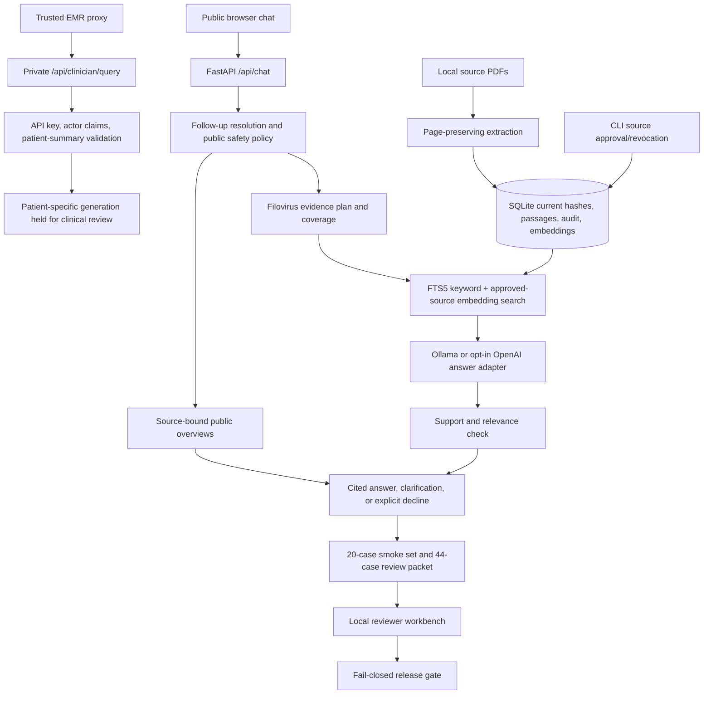

# Afya Msaada architecture

This implementation adapts the **component structure** of the local `kenya-afya-bot` project to filovirus guidance. It does not copy HIV-specific plans, patient fields, guideline content, secrets, deployment credentials, or clinical approvals.

## Component mapping

| `kenya-afya-bot` pattern | Afya Msaada implementation |
| --- | --- |
| `document_processor.py`, offline ingestion | `sources/processor.py`, CLI import and rebuild; PDF page numbers preserved |
| `vector_store.py`, active guideline filter | SQLite FTS5 plus model-specific embeddings; exact approved SHA-256 filter and build status |
| `query_guard.py` | `conversation/context.py` and `policy/guard.py` |
| `evidence_registry.py` | `retrieval/planner.py` and evidence coverage check |
| `rag_chain.py` | `answering/public_summaries.py` for narrow cited overviews; `answering/pipeline.py` for source selection, draft, support check |
| `config.py`, model providers | `models/provider.py`; Ollama default, OpenAI opt-in |
| `assistant_api.py`, patient contract | FastAPI public/private endpoints and `patient/contract.py`; patient-specific generation held |
| golden evaluator and pilot readiness | `evals/run.py`, local reviewer workbench, `evals/readiness.py`, `infra/preflight.py` |

## Boundaries

Source registration does not approve content. Import records PDF bytes and page passages. Approval applies to an exact file hash. A changed or missing PDF is revoked before search. Rebuilding passage extraction for an unchanged PDF preserves its approval but invalidates embeddings until `index` completes.

The public API sends only the current question and selected approved passages to the configured model. Earlier **user questions** can resolve a follow-up; earlier answers never become evidence. Patient summaries stay outside this path. The private endpoint validates patient data and actor claims, then returns `clinical_review_required`; it does not personalize an answer or write to an EMR.

Short, general questions about Ebola isolation, treatment, or vaccines use fixed summaries only when their exact supporting passage remains approved. They carry page citations and date-bound caveats. Detailed clinical procedures, personal treatment choices, and claims about current local availability still decline.

General Ebola model retrieval excludes Bundibugyo-specific documents unless the question names Bundibugyo. The fixed vaccine overview explicitly compares the two species and cites the relevant Bundibugyo page.

The 44-case packet records code, source, case-set, answer-model, and embedding-model fingerprints. Reviewers must inspect original PDF pages and rate accuracy, support, clarity, and safety. The release gate requires two distinct passing reviewers per case and an authority signoff matching that exact run. This local gate is necessary evidence, not a substitute for institutional authentication or privacy approval.
